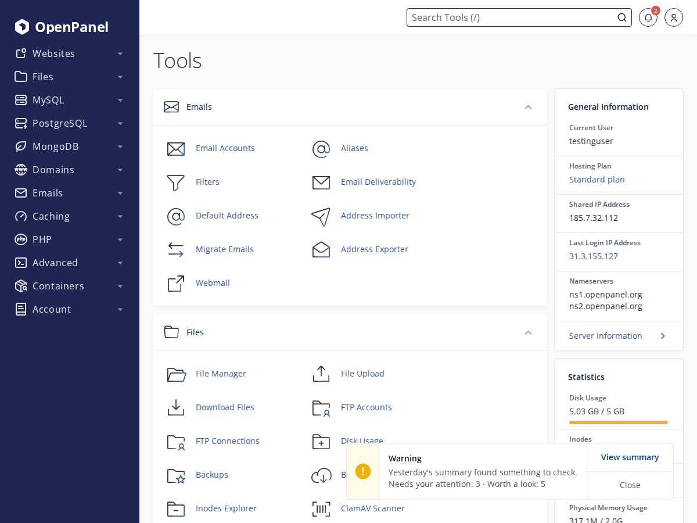

# saturn-openpanel-theme

Saturn is a theme for the OpenPanel 2.x user panel with a classic hosting panel look: navy sidebar, light canvas, Open Sans, a **Search Tools (/)** box in the header, and a dashboard that is only the **Tools** page with **General Information** and **Statistics** on the right.



## Install

```bash
git clone https://github.com/stefanpejcic/saturn-openpanel-theme /etc/openpanel/openpanel/templates/saturn
opencli config update template saturn
```

Or pick **saturn** in **OpenAdmin > Settings > OpenPanel > Theme**.

## What it changes

- `static/css/saturn.css`: all the styling (colors, sidebar, header, cards, tables, dashboard tools). Loaded after the panel's own CSS, so it only overrides.
- `static/fonts/open-sans/`: Open Sans (SIL Open Font License, see `LICENSE.txt` there).
- `static/fonts/phosphor/`: Phosphor Light (MIT, see `LICENSE` there), the thinner two-tone tool icons on the dashboard.
- `base.html`: loads the stylesheet and Bootstrap Icons, 240px sidebar, no tabs bar on the dashboard.
- `dashboard/dashboard.html`: no Overview, only Tools: sections in one column, General Information and Statistics on the right.
- Always the classic grouped menu (sets the `menu_style=classic` cookie once), no tabs bar under the header, no breadcrumbs, light mode only (no theme switcher, ignores the device's dark setting).
- `user/_login.html`, `user/login.html`, `static/css/saturn-login.css`: the login page (centred logo, icon fields, blue button, language row, copyright).
- `system/server_info.html`: server, hosting package and panel information as three tables on one page.
- `/dashboard#trademarks`: trademarks notice, linked from the page footer.
- `partials/_search.html`: the header search is always open, focused on the dashboard, `/` focuses it, and on the dashboard it also filters the tools.

Every other template is the built-in one, so you can delete the files this theme doesn't touch and they will follow panel updates.

Based on [bootstrap-openpanel-theme](https://github.com/stefanpejcic/bootstrap-openpanel-theme).
